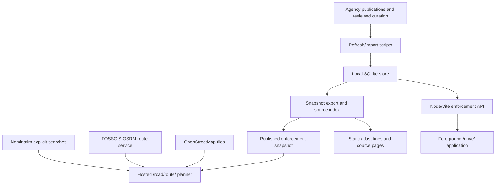

# Technical specification: road intelligence

Version 1.0 · November 8, 2026. “Existing” describes committed code; “proposed” describes work that still needs implementation and source access.

## Existing architecture

The hosted Site is static. It cannot hide server credentials or run the SQLite backend. The globe/Drive application has separate Node provider middleware. The upstream TomTom tile proxy is separate from the hosted road planner and must not be advertised as its live traffic source.

## Code ownership and entry points

| Area                       | Files                                                                                  | Contract                                                                             |
| -------------------------- | -------------------------------------------------------------------------------------- | ------------------------------------------------------------------------------------ |
| Hosted planner             | `road/route/index.html`, `src/road/planner.js`, `src/road/routing.js`                  | Endpoints, route alternatives, Leaflet display and route-context matching            |
| Hosted atlas/fines/sources | `road/index.html`, `road/fines/index.html`, `road/sources/index.html`, `src/road/`     | State coverage, legal scenarios, hardware simulation and provenance                  |
| Driving frontend/model     | `src/driving/app.js`, `map.js`, `model.js`, `navigation.js`, `source.js`, `layer.js`   | Foreground GPS, canonical record validation, alert association and globe integration |
| Store/API                  | `server/enforcement/store.js`, `plugin.js`, `source-index.js`                          | SQLite, moderated reports, inventory queries and provenance export                   |
| Import/curation            | `scripts/enforcement/refresh.mjs`, `adapters.mjs`, `manage.mjs`, `watch.mjs`           | Public source ingestion, review and atomic accepted updates                          |
| Published data             | `public/enforcement/snapshot.json`, `curation/sources/registry.json`, `curation/laws/` | Dated accepted inventory, separate source/rights status and reviewed monetary rules  |
| Build                      | `build/vite.js`, `package.json`                                                        | Multi-entry Vite build; supported Node range is authoritative in package.json        |
| Existing upstream traffic  | `server/providers/traffic.js`                                                          | Optional server-side TomTom tile proxy; not the hosted planner traffic integration   |

## Existing acquisition and storage

PA WZSSC location data and GIS geometry are joined by source identifiers/location codes. NYSDOT weekly deployment PDFs are discovered from the official program page and extracted with `pdftotext -layout`; absent corridor entries remain absent. Optional bounded OSM interstate-node queries have not contributed accepted records. The 49 curated NYC/PA monitoring sites have source site coordinates, not independently verified mount coordinates.

Canonical records preserve ID, source ID/URL, state/route, type, status, geometry/precision, coordinate meaning, retrieval time, applicable dates, travel-direction references, source-reported speed limits, mileposts and evidence. Consult `normalizeRecord` in `src/driving/model.js` for executable validation; the prose is not a second incompatible schema. Mobile observations require observation/expiry timestamps. Review candidates and quarantined mismatches are excluded from published equipment imports.

The SQLite store is local to the backend. Inventory API data, report moderation and snapshot export are separate from static publication. Do not commit `.gev-data/`, credentials, private report queues or license correspondence. Accepted source failures preserve prior records with their original dates; disappearance handling must not become a claim that enforcement is off.

## Existing hosted routing contract

- Input coordinates are explicitly latitude, longitude; internal geometry uses GeoJSON longitude, latitude.
- Place searches go to `https://nominatim.openstreetmap.org/search` with US country filter, five-result limit and explicit user action. No autocomplete. Serialized requests have at least 1.1-second spacing and page-memory caching.
- Routes go to `https://routing.openstreetmap.de/routed-car/route/v1/driving/…` with GeoJSON geometry, full overview, steps and alternatives. No API key; service availability is not guaranteed.
- Normalize at most three routes; reject invalid coordinates/geometries, nonfinite distances/durations and more than 100,000 geometry points. Step normalization is bounded at 200 steps.
- Requests omit credentials and use origin-only referrers. Routes cache for ten minutes in page memory; clear removes cache. Public provider limits still apply across users at production scale.
- Geocoding times out after 15 seconds; route requests after 30 seconds. Input changes abort/invalidate prior route requests; cancellation cannot restore a stale route.
- GPS selects one starting fix explicitly. Accuracy worse than 100 m is rejected. This page does not continuously navigate or automatically reroute.

## Existing route-context algorithm

`matchRouteIntelligence` projects source points/segments onto the route, finds nearest segment crossings/proximity and orders matches by cumulative route offset. The UI exposes 100/250/500 m corridor radii, default 250 m. Known opposite-direction and historical records are excluded by default. Direction alignment uses a 65-degree tolerance; unknown direction remains explicitly unknown.

The stronger “road and direction references align” label needs matching road references, aligned direction and proximity within 30 m. This remains reference association, not physical equipment verification. Parallel roads, grade separation, missing directions and project geometry can still make lane association uncertain. Source point markers retain source coordinates; project reference pins do not invent mounts. Source highway mileposts differ from trip-distance offsets. Source speeds are not inferred current posted limits.

## Proposed live-data architecture (not implemented)

Use a provider interface that separates route calculation, traffic observations, incidents, imagery and enforcement state. Keep API credentials in server/Worker secrets, except a purpose-restricted Google browser-map key. A static Site needs a supported backend/Worker migration for secret-bearing calls, quotas and shared caching. Do not place Routes/agency server keys in bundled JavaScript.

1. Google Maps JavaScript API renders a licensed map and `TrafficLayer`; Google refreshes frequently, not instantaneously.
2. Routes API returns traffic-aware routing/ETA for an explicit departure basis. Save retrieval time and label the selected routing preference; traffic-aware and baseline estimates must never be conflated.
3. Agency adapters normalize permitted incidents, project references and camera metadata separately. Playback URLs require authorized use, compatible stream protocols and capture-time/availability handling.
4. Only an authorized explicit enforcement-status source can produce a confirmed operating observation. No such source is connected.
5. Provider errors expose unavailable/stale state, retain original evidence dates and never silently become “clear road” or “not enforcing.”

Google response display, storage and reuse must follow [Routes policies](https://developers.google.com/maps/documentation/routes/policies) and the applicable [Maps terms](https://cloud.google.com/maps-platform/terms). Do not assume Google-derived traffic/routes can be copied into a permanent open database or drawn on an arbitrary non-Google map. Review architecture before replacing the current Leaflet/OSRM path.

## Proposed normalized observations

These are design contracts, not existing API endpoints or database migrations.

| Observation             | Required fields                                                                                                                     | Meaning                                                              |
| ----------------------- | ----------------------------------------------------------------------------------------------------------------------------------- | -------------------------------------------------------------------- |
| Traffic flow            | provider/source URL, segment ID and geometry, observed/retrieved/expiry times, units, speed, baseline if actually supplied, quality | Measured/estimated traffic; a flow speed is not a posted speed limit |
| Incident                | provider ID, geometry/precision, type, direction/road association, reported/updated/expiry times                                    | Agency report with validity and attribution                          |
| Camera media            | agency/device ID, site geometry/meaning, allowed image/stream URL, captured/retrieved times, availability, rights reference         | Monitoring imagery; no citation inference                            |
| Enforcement observation | exact matched device ID, explicit state, source event/receipt/expiry times, authoritative evidence and rights reference             | Optional actual operating evidence, separate from project status     |
| Permission              | provider, dataset, allowed uses, attribution, quotas, cache/retention, term/review dates and private agreement reference            | Access approval is separate from commercial clearance                |

Proposed enforcement state values: `unknown`, `scheduled`, `confirmed-operating`, `confirmed-not-operating`. “Scheduled” is never promoted by a clock alone. Confirmed values require explicit authoritative device-level evidence and an agreed freshness window; expiry becomes unknown. The current inventory retains its existing project/source statuses and does not implement these new states.

## Freshness and association requirements for future adapters

- Preserve source time separately from ingestion time. Reject impossible/future timestamps; do not interpret timezone-less values silently.
- Establish provider-specific expiry from its documented cadence and event semantics before enabling a “live” label. A universal seven-day record freshness rule is not adequate for live flow or activation.
- On HTTP failure, clock ambiguity, out-of-order events, invalid coordinates or schema change, mark unavailable/unknown and retain diagnostics without leaking keys.
- Avoid route-nearest-only assignment of traffic speeds to parallel carriageways. Validate road IDs, direction and geometry/coverage before modifying ETA or issuing alerts.
- Use shared bounded cache/single-flight, backoff, request budgets and provider-specific limits. Visible-page refresh only unless a separately reviewed background service is implemented.
- Public media playback must disclose source, timestamps, outages and any limits on recording. Do not archive faces/plates or add identification features.

## Security, privacy and deployment

Restrict browser keys to the exact Site origin and required API; use a distinct server key with appropriate provider-supported restrictions. A backend needs request validation, rate limiting, spend controls and private secrets. Budget alerts do not cap charges. Never commit keys or signed application documents. Keep precise route history off analytics by default. The hosted planner currently stores trips only in page memory; law scenario sharing has a separate limited query-string contract.

Source repository: `https://github.com/rtmendes/gods-eye-view`, branch `feat/corridor-driving`, draft PR #2. The existing static Site project is `appgprj_6aef056b1f7881919ec6d4134aafadfd`; preserve its identity/audience. Push exact Site source state before deployment; packaged assets must match that pushed commit. App repository commits and the generated Site repository commits are distinct provenance records.

## Validation and rollout

Existing commands: `npm run test:driving`, `npm run qa:route`, `npm run qa:road`, `npm run qa:sources`, `npm run check:boundaries`, `npm run build`. Browser tests need a running appropriate local server and Chromium. Unit fixtures verify logic, not agency uptime or real traffic accuracy.

Future live adapter tests must cover no key, invalid/revoked credentials, exhausted quota, partial coverage, delayed source times, timezone/DST ambiguity, expired operating evidence, camera offline state, conflicting IDs, wrong carriageway, malformed payloads, attribution and commercial-display restrictions. A live smoke test needs approved credentials and an authorized low-volume request. No test can establish exhaustive national camera detection.

Enable one pilot provider behind a disabled-by-default feature flag after access approval, evidence checks and cost controls; preserve the current route provider as an explicitly labeled baseline fallback. Roll back the flag independently of inventory publication. See [SOP](SOP.md) for release steps.
